# DiscPuter

A USB optical drive emulator for the M5Stack CardputerZero: keep OS installer images on the SD card,
plug the CardputerZero into a computer and it sees a CD/DVD drive with the disc you picked on the
CardputerZero's own screen and keyboard.

Inspired by [USBODE](https://github.com/danifunker/usbode-circle) (danifunker, GPL-3.0), which does
this bare-metal on a Raspberry Pi Zero with Circle. DiscPuter runs on the CardputerZero's Linux
(Raspberry Pi CM0) and is a separate project; parts of its later CD emulation may be ported from
USBODE, so it is GPL-3.0 as well.

## Hardware

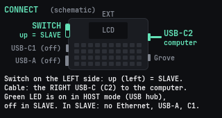

The same picture opens first in the app's help (F1).

- **Host/Slave switch** (left side) on **Slave** (up / left; the green LED is off in Slave): the CM0 USB goes straight to the **right USB-C**
  port. The internal USB hub is off then: no Ethernet, USB-A, left USB-C or EXT USB. Wi-Fi works.
- USB device controller: `dwc2` (`/sys/class/udc/3f980000.usb`, device tree `dr_mode = otg`).
- Kernel functions available: `usb_f_mass_storage` (CD-ROM or disk), `usb_f_fs` (gadget in userspace).

## Iterations

| # | What | Status |
|---|---|---|
| 0 | `scripts/cz-gadget.sh`: kernel mass-storage gadget by hand, does a computer see a CD and boot from it? | CD + swap ✅ on macOS; boot on a PC: to test |
| A | CardputerZero app: list images, insert / eject / swap, CD or disk mode, through the kernel gadget (ISO only) | 0.1.0 works on the device; 0.2.0: copy images in over USB, store-ready packaging |
| B | own gadget over FunctionFS with SCSI/MMC: BIN/CUE, CD audio, multi-disc, better old-OS compatibility | planned |

## Iteration 0: test

On the CardputerZero (as root):

```bash
sudo ~/discputer/cz-gadget.sh up ~/discputer/images/dptest1.iso      # CD-ROM with disc 1
sudo ~/discputer/cz-gadget.sh status                                  # state=configured: the host sees us
sudo ~/discputer/cz-gadget.sh swap ~/discputer/images/dptest2.iso     # change the disc
sudo ~/discputer/cz-gadget.sh eject
sudo ~/discputer/cz-gadget.sh down
```

`up <image> disk` shows the image as a read-only removable disk instead of a CD: hybrid Linux ISOs
and some UEFI firmware prefer that.

Checklist:

1. ✅ Data ISO on a Mac / PC: a CD drive appears and the disc mounts (`dptest1.iso` → `HELLO.TXT`). Mac: works (2026-11-25).
2. ✅ Swap: the computer gets the new disc (`dptest2.iso` → `SWAPPED.TXT`). Mac: works with `swap` + `replug` as needed (2026-11-25).
3. Boot: a real installer ISO (Linux, Windows) boots on a PC from the "USB CD" in BIOS/UEFI.
4. Big images: a > 4 GB DVD ISO (Windows 10/11) reads fine.
5. `disk` mode with a hybrid Linux ISO boots where `cd` mode does not (or the other way round).

## The app (iteration A)

| | |
|---|---|
| 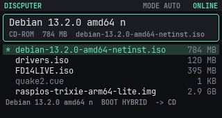 | 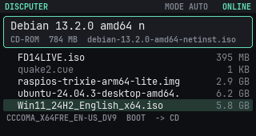 |
| 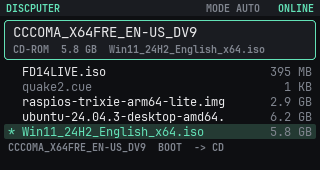 | 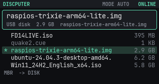 |
| 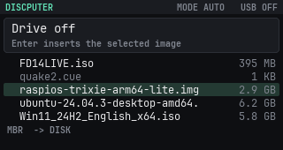 | |
| 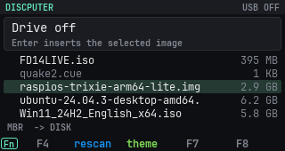 | 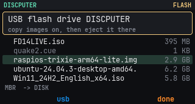 |
| 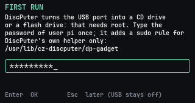 | 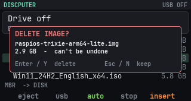 |
|  | 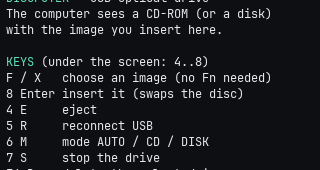 |

- **Copying images in over USB** (0.2.0): `U` or Fn+7 turns the drive into a writable USB flash drive
  `DISCPUTER` (exFAT). Copy images onto it from the computer and eject it there: the app notices the
  eject and moves every file into `~/discputer/images` (`8` = done, if the cable was just pulled).
  The drive is a sparse file `/var/lib/cz-discputer/drop.img` (free space minus 2 GiB, at most 64 GiB),
  made fresh each time and deleted after the import; macOS `._*`, `.Spotlight-V100` etc. are skipped.
  Measured: ~10 MB/s copy onto it, then ~10 MB/s import on the SD card (200 MB: 19 s + 21 s, md5 ok).
- Images live in `~/discputer/images` on the CardputerZero (copied in over USB, or `scp` over Wi-Fi).
  `D`, Del or Fn+4 deletes the selected one after a confirmation (not while it is in the drive). Each one shows its
  volume label and what it is: `BOOT` (El Torito), `HYBRID` (also boots as a USB disk), `DATA`, `MBR`/`GPT`/`RAW`
  disk images, `BIN/CUE` (iteration B).
- `Enter` inserts the selected image; with a disc already in, it swaps and reconnects USB so every host
  notices. `E` eject, `R` reconnect, `S` stop the drive, `M` mode AUTO / CD / DISK (AUTO: CD for ISOs,
  disk for `.img`). The drive keeps running after the app exits. Labels over keys 4..8 show these
  actions; with Fn tapped they switch to Fn+4..8 (F5 rescan, F6 theme).
- Status: `ONLINE` = a computer uses the drive, `NO HOST` = the switch or the cable, `USB OFF` = stopped.
- Privileges: the app runs as `pi`; the package installs a root helper `/usr/lib/cz-discputer/dp-gadget`.
  The package itself does not touch sudo (the CardputerZero Store forbids that in maintainer scripts):
  on the first run the app shows a FIRST RUN screen, takes the user's password once and runs
  `sudo -S dp-gadget setup`, which adds a rule for the `plugdev` group and this helper only
  (`/etc/sudoers.d/cz-discputer`, checked with `visudo`). Removing the package removes the rule (prerm).
  The helper only accepts images under `~/discputer/images`, `/media` or `/mnt`, always read-only;
  the only writable drive is its own `/var/lib/discputer/drop.img`, and the import runs the file
  operations in the user's home as that user (`runuser`).

## Development

DiscPuter builds through [cardputer-zero-tools](https://github.com/heartpolik/cardputer-zero-tools)
(czkit runtime, LVGL, packaging), checked out next to this repo (or `CZ_TOOLS=...`):

```
scripts/dp sim     desktop simulator (simulated USB drive; DP_IMAGES=<dir> for another folder)
scripts/dp test    host tests of the image inspector
scripts/dp shots   screenshots from fake images (scripts/make-demo-images.py)
scripts/dp deb     arm64 .deb in Docker -> dist/
scripts/dp push    build + install on the device
```

## License

GPL-3.0, see [LICENSE](LICENSE).
